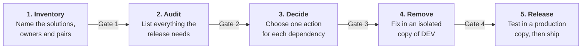

# Power Platform dependency audit

[](https://github.com/david-lorenzo88/power-platform-dependency-audit/actions/workflows/tests.yml)

Release one Power Platform project to production while others are still in development.

This repository finds everything your release needs that production doesn't have, including components that belong to projects you can't ship yet. It then gives your team a process to remove those dependencies and prove the result with a clean import.

It covers:

- Dataverse solutions, including a release made of several solutions
- Plug-ins and Azure Functions, in the Azure DevOps branches you choose
- Power Pages sites
- SharePoint sites, lists and columns

You can run the scripts by hand on macOS, Windows or Linux, or let an AI agent run them through the included skills.

> [!IMPORTANT]
> **Tested on simulated services, not yet on a live tenant.** The automated tests use local copies of the Dataverse, Graph and Azure APIs, built from Microsoft's documentation, and real local Git repositories. Try your first run on a non-critical environment, and check a few rows against the maker portal's "Show dependencies" view. Please [open an issue](https://github.com/david-lorenzo88/power-platform-dependency-audit/issues) if something doesn't match. Leave out customer names and data, because issues are public.

## How it works

The process has five phases. Each one ends with a gate that someone must sign off.



Three rules apply throughout:

- **The platforms supply the facts.** Scripts extract the data, an agent can analyze it, and people make the decisions.
- **Nothing shared gets changed by accident.** The audits only read. The one script that writes refuses to run on DEV or production.
- **Only a clean import counts as proof.** A dependency is resolved when the managed files import and pass their tests in a copy of production.

To see what the audit produces, look at the [sample output](examples/sample-output/dependency-map.md), generated from simulated environments.

## What's in this repository

| Script | What it does | Changes anything? |
| --- | --- | --- |
| [`solution_dependency_audit.py`](scripts/solution_dependency_audit.py) | Audits the Dataverse solutions and plug-ins, and works out the release order | No, it only sends GET requests |
| [`external_dependency_audit.py`](scripts/external_dependency_audit.py) | Audits SharePoint and Azure Functions | No, it only sends GET requests |
| [`fetch_audit_sources.py`](scripts/fetch_audit_sources.py) | Lists Azure DevOps repositories and branches, and downloads the ones you choose | Only reads from Azure DevOps, and writes to your local folder |
| [`stage_solution.py`](scripts/stage_solution.py) | Dry-runs an import on a sandbox | **Yes, on the sandbox only.** It uploads the file there |
| [`check_setup.py`](scripts/check_setup.py) | Checks the tools, sign-ins and project folder, and validates `audit-config.json` | No |

The [playbook](docs/playbook.md) has the decision questions and a fix for each type of dependency. The two [skills](skills) let Claude Code or GitHub Copilot CLI run the audits and ask the right questions.

## Before you start

### Software

| Tool | Needed for | Check with |
| --- | --- | --- |
| Python 3.9 or later | All scripts. They use only the standard library, so there's nothing else to install | `python --version` |
| Git 2.31 or later | Downloading branches | `git --version` |
| [Azure CLI](https://learn.microsoft.com/cli/azure/install-azure-cli) | Signing in | `az --version` |
| [Power Platform CLI](https://learn.microsoft.com/power-platform/developer/cli/introduction) | Exporting, unpacking and importing solutions | `pac help` |

The commands below use `python`. If that isn't found, use `python3` on macOS and Linux, or `py -3` on Windows.

### Access

| Where | Access needed | Used by |
| --- | --- | --- |
| DEV and production | A Dataverse role that can read solutions and customizations. System Customizer should be enough | Both Dataverse scripts |
| Sandbox | System Customizer or System Administrator | `stage_solution.py` |
| Azure DevOps | Code (read) on each repository | `fetch_audit_sources.py` |
| Each function app | The Azure Reader role | `external_dependency_audit.py` |
| SharePoint | A Microsoft Graph token with `Sites.Read.All` or `Sites.Selected` | `external_dependency_audit.py` |

Skip Azure DevOps, function apps and SharePoint if your release doesn't use them.

### Environments

| Environment | Purpose | Warning |
| --- | --- | --- |
| DEV | Where the solutions are built | Only read during the audit |
| Production | What you compare against | Only read during the audit. You can use a fresh copy instead |
| Sandbox | Dry runs. Holds a copy of production | **Copying overwrites the environment you copy to** |
| Release copy | Phase 4: an isolated copy of DEV, where fixes happen | Copying overwrites this one too |

### People

| Role | Responsibility |
| --- | --- |
| Release lead | Owns the process, the decision register and each gate |
| Business owner | Confirms what ships and what can wait |
| Project owners | One per in-flight solution. They approve changes to their components |
| Operator | Runs the scripts or the agent, and reviews the results |
| Platform admin | Creates environments, grants access and runs the production import |
| Power Pages, SharePoint and Azure owners | Own those systems, and apply changes there |

## Set up

### 1. Get the tools

You only need one of these.

**To run the scripts by hand:**

```bash
git clone https://github.com/david-lorenzo88/power-platform-dependency-audit.git "$HOME/tools/power-platform-dependency-audit"
```

**To use an AI agent**, run these inside a Claude Code session:

```text
/plugin marketplace add david-lorenzo88/power-platform-dependency-audit
/plugin install dependency-audit@power-platform-dependency-audit
```

This adds two skills: `solution-dependency-audit` and `external-dependency-audit`. The plugin installs and validates in Claude Code. GitHub Copilot CLI reads the same manifest files, but this hasn't been tested yet.

To start, open a session in the customer's private project folder and ask for the audit. [The agent then sets itself up](docs/agent-setup.md):

1. **It checks your computer.** It runs `check_setup.py`, and tells you what to install or sign in to. You run the sign-ins yourself.
2. **It shows who you're signed in as.** You confirm the account, tenant and project folder are the right customer's.
3. **It asks about the release.** You give the solutions, the DEV, production and sandbox addresses, what the release includes, and the Azure DevOps projects.
4. **It saves your answers in `audit-config.json`.** Later runs show them for you to confirm, rather than asking again. The file holds no secrets, and refuses any setting it doesn't recognize.
5. **It asks for the repositories and branches.** It does this on every run, so an audit never reads the wrong code by accident.

It then follows the same steps as below.

The fixes in the playbook can also use Microsoft's [power-platform-skills](https://github.com/microsoft/power-platform-skills) plugins, which are optional.

> [!WARNING]
> Get the customer's approval before an AI agent reads their metadata or code. Don't turn on `--dangerously-skip-permissions` or `--allow-all-tools` for this work, because they give the agent your full access.

### 2. Work in a private project folder

**Run everything from the customer's private repository, and never from this public one.** Audit results name customer components. This repository's `.gitignore` blocks them, as a safety net.

```text
customer-project/          Private repository
├── audit/                 Results. Commit these
├── build/                 Solution files. Don't commit
├── solutions/Core/        Unpacked solutions. Commit these
├── solutions/Sales/
├── sources/               Downloaded branches and site. Don't commit, and delete after the release
├── audit-config.json      Solutions, environments and scope, saved by the agent
├── audit-sources.json     The repositories and branches for this run
└── external-map.json      SharePoint and function app pairs
```

Add `build/` and `sources/` to that repository's `.gitignore`.

### 3. Set your variables

Run this once in each new terminal, with your own values. The examples below release two solutions, **Core** and **Sales**. If your release has one solution, drop the lines for the other.

**macOS and Linux:**

```bash
export DEV=https://contoso-dev.crm.dynamics.com
export PROD=https://contoso.crm.dynamics.com
export SANDBOX=https://contoso-prodcopy.crm.dynamics.com
export RELEASE=https://contoso-release.crm.dynamics.com
export TOOLS=~/tools/power-platform-dependency-audit/scripts
```

**Windows PowerShell:**

```powershell
$DEV = "https://contoso-dev.crm.dynamics.com"
$PROD = "https://contoso.crm.dynamics.com"
$SANDBOX = "https://contoso-prodcopy.crm.dynamics.com"
$RELEASE = "https://contoso-release.crm.dynamics.com"
$TOOLS = "$HOME\tools\power-platform-dependency-audit\scripts"
```

The commands below work in both shells. Where a command spans several lines, PowerShell needs a backtick (`` ` ``) in place of each trailing `\`.

### 4. Sign in

```bash
az login --tenant <tenant-id>
pac auth create --environment $DEV
```

### 5. Check everything is ready

Run this from your project folder. It prints a fix for anything missing, and shows which account and tenant you're signed in to, so you can confirm they're the customer's.

```bash
python "$TOOLS/check_setup.py"
```

It can't prove your access to an environment. The `--check` option in steps 7 and 10 does that.

## Phase 1: Inventory

This phase records what's being released and who owns it. Nothing changes in any environment.

**1. Name the solutions in the release.** The release lead and business owner agree what ships. List every solution by its unique name, not its display name, and name an owner for each.

```bash
pac solution list --environment $DEV
pac solution list --environment $PROD
```

**2. Export and unpack each solution.** This puts it in source control, so every later fix shows as a diff. Name each folder after its solution, because the audit uses the folder name to tie findings to that solution.

```bash
mkdir build

pac solution export --name Core --path ./build/Core.zip --managed false --overwrite --environment $DEV
pac solution unpack --zipfile ./build/Core.zip --folder ./solutions/Core --packagetype Unmanaged --allowWrite --allowDelete

pac solution export --name Sales --path ./build/Sales.zip --managed false --overwrite --environment $DEV
pac solution unpack --zipfile ./build/Sales.zip --folder ./solutions/Sales --packagetype Unmanaged --allowWrite --allowDelete
```

**3. Download the Power Pages site**, if it's part of the release. Skip this step if not.

```bash
pac pages list --environment $DEV
pac pages download --path ./sources/site --webSiteId <site-id> --modelVersion 2 --environment $DEV
```

For a code site, use `pac pages download-code-site --path ./sources/site --webSiteId <site-id> --environment $DEV`.

**4. Pair each SharePoint site and function app.** Copy [`external-map.example.json`](examples/external-map.example.json) to `external-map.json`, and fill in every DEV site and function app with its production pair. Skip this step if the release uses neither.

**5. List the code repositories.** Note which Azure DevOps repositories hold the plug-ins and functions, and which function app each one deploys to.

> **Gate 1:** the business owner has approved the scope, every solution has a named owner, and each site and function app has an owner and a production pair.

## Phase 2: Audit

This phase produces one list of everything the release needs, and a map of its structure. It uses several sources, because each one misses something the others catch.

| Source | Finds | Misses |
| --- | --- | --- |
| Dependency graph (Web API) | References Dataverse tracks between components | References in code and text |
| Text scan | In-flight names in flows, scripts, forms, canvas apps, the site and your branches | Names built at runtime. It can also raise false positives to review |
| Branch comparison | Plug-in types and functions a branch would add to or remove from production | Function names held in constants, which it lists for a manual check |
| Dry run (`StageSolution`) | What a copy of production would actually reject | Failures at runtime. A flow can install and still not work |
| External audit (Graph, Azure) | SharePoint and Azure Functions items production lacks, hardcoded addresses and function keys | Addresses set at runtime, which it lists for a manual check |

**6. Choose the code, and download it.** Do this on every run, and always name the branch you're releasing rather than assuming the default one. Skip it if the release has no custom code.

```bash
python "$TOOLS/fetch_audit_sources.py" list-repos --organization contoso --project App
python "$TOOLS/fetch_audit_sources.py" list-branches --url https://dev.azure.com/contoso/App/_git/plugins
```

Copy [`audit-sources.example.json`](examples/audit-sources.example.json) to `audit-sources.json`, and fill in your choices. Then download them. This records the exact commit of each branch in `audit/sources-lock.json`.

```bash
python "$TOOLS/fetch_audit_sources.py" fetch --manifest audit-sources.json
```

If your code isn't in Azure DevOps, clone each branch yourself and pass its folder with `--scan-dir` in steps 9 and 10. The text scan and the plug-in check still work, but the function comparison in step 10 doesn't, so compare those branches with production by hand.

**7. Confirm what the audit will read.** This checks your sign-in and shows the environments and solutions.

```bash
python "$TOOLS/solution_dependency_audit.py" --target Core --target Sales --dev $DEV --prod $PROD --check
```

**8. Dry-run each solution on a sandbox.** First, the platform admin copies production to the sandbox, which **overwrites the sandbox**. Then export each solution as managed, and stage it. `stage_solution.py` refuses to run on DEV or production.

```bash
pac admin copy --name ProdCopy --source-env $PROD --target-env $SANDBOX --type MinimalCopy

pac solution export --name Core --path ./build/Core_managed.zip --managed true --overwrite --environment $DEV
python "$TOOLS/stage_solution.py" --zip ./build/Core_managed.zip --sandbox $SANDBOX --dev $DEV --prod $PROD

pac solution export --name Sales --path ./build/Sales_managed.zip --managed true --overwrite --environment $DEV
python "$TOOLS/stage_solution.py" --zip ./build/Sales_managed.zip --sandbox $SANDBOX --dev $DEV --prod $PROD
```

Each run writes `audit/stage-<solution>.json`. A failed dry run is normal at this point, and the audit needs its file. If Sales needs something from Core, its dry run lists that as missing. The audit expects this and doesn't count it as a problem.

**9. Run the Dataverse audit.** Pass every solution, every folder to search and every dry run.

```bash
python "$TOOLS/solution_dependency_audit.py" \
  --target Core --target Sales \
  --dev $DEV --prod $PROD \
  --scan-dir ./solutions/Core --scan-dir ./solutions/Sales --scan-dir ./sources/site \
  --sources-lock audit/sources-lock.json \
  --stage-json audit/stage-Core.json --stage-json audit/stage-Sales.json
```

Leave out `--scan-dir ./sources/site` if you have no site, and `--sources-lock` if you downloaded no code. Keep a `--scan-dir` for every solution: the audit blocks Gate 2 if one has no folder named after it.

**10. Run the external audit**, if the release uses SharePoint or Azure Functions.

```bash
python "$TOOLS/external_dependency_audit.py" --map ./external-map.json --check

python "$TOOLS/external_dependency_audit.py" --map ./external-map.json \
  --sources-lock audit/sources-lock.json \
  --scan-dir ./solutions/Core --scan-dir ./solutions/Sales --scan-dir ./sources/site
```

An Azure CLI token often lacks SharePoint access. If Graph answers 401 or 403, pass a command that prints a suitable token:

```bash
--graph-token-command "<command that prints a Graph token>"
```

**11. Read the results.** Open `audit/dependency-map.md` and `audit/external-map.md`. Their diagrams use Mermaid: GitHub draws them, and so does VS Code with a Mermaid extension. Azure DevOps may show them as text. Start with these sections:

- **Gate 2** lists what's still blocking.
- **Release order** gives the order to import the solutions.
- **Fix these first** ranks components by how many rows a fix would clear.
- **Solutions** shows what each solution needs, in one picture.

[What each status means](#statuses) is below.

**12. Explain what needs explaining.** In `audit/dependencies.csv` and `audit/external-dependencies.csv`, fill in the `explanation` column for every Unknown row and every row with a `reconcile_note`. Any text clears it for Gate 2, but the row stays open until it's fixed or closed. See [what closes a row](#what-closes-a-row).

Don't edit the `status` column. Run steps 9 and 10 again, and your explanations carry over, even if you saved the file from Excel.

> **Gate 2:** both maps say Gate 2 is ready. Commit `audit/` to the private repository.

**With an AI agent**, steps 6 to 12 become one prompt. It asks for whatever it doesn't know:

```text
Run solution-dependency-audit, then external-dependency-audit.
Confirm each environment with me before the first read, and the sandbox before any dry run.
Check each text-scan hit and mark false positives. Explain any row found by only some sources.
Report what still blocks Gate 2. Never turn a failed check into a clean result.
```

## Phase 3: Decide

Every open row gets one action and a recorded approval.

**13. Group the rows.** Start with the components that clear the most rows. `audit/impact.csv` shows who else uses each one.

**14. Choose an action for each row.** The [playbook](docs/playbook.md) has five questions that lead to one action.

| Action | Meaning |
| --- | --- |
| Trim | Take the component out of the release |
| Sever | Remove the reference to the in-flight component |
| Promote | Move the in-flight component to a shared solution, and ship it |
| Defer | Ship it with or after the project it needs |
| Redesign | Rebuild it so it doesn't need the in-flight component |

**15. Mark the fix type.** Permanent fixes also go back to DEV. Release-only fixes stay in the release copy, because an in-flight project still needs that reference.

**16. Record and approve.** Keep the decisions in `audit/decision-register.csv`, using [the example](examples/decision-register.example.csv) as a template. The owners of both components approve each action, and the business owner approves any Defer.

If most rows point to one in-flight project, raise it now. Releasing that project first, or part of it, may cost less.

> **Gate 3:** every open row has an approved action and a fix type.

**With an AI agent**, it can draft the register, but only people approve it:

```text
Read audit/dependencies.csv, audit/external-dependencies.csv, audit/impact.csv and docs/playbook.md.
For each open row, propose one action: Trim, Sever, Promote, Defer or Redesign. Give the evidence.
Group rows by required component, starting with those that clear the most rows.
Write audit/decision-register.csv with every row set to Proposed. Only a person can approve a row.
```

## Phase 4: Remove

Fixes happen in an isolated copy of DEV, so in-flight projects keep working. If each project has its own DEV environment, work in the release's own environment instead.

**17. Create the release copy.** The platform admin runs this, and it **overwrites the target environment**. Open a `release/<name>` branch in Git.

```bash
pac admin copy --name Release --source-env $DEV --target-env $RELEASE --type MinimalCopy
```

**18. Prepare a shared solution, if any row says Promote.** If the release already has a shared base solution, use it. If not, create one with the same publisher, and add only what the register names. Don't use `--AddRequiredComponents`, because it pulls in whatever the component needs, including in-flight work.

**19. Apply the fixes in batches**, using the [playbook](docs/playbook.md). Start with those that clear the most rows.

Some systems need their own way to isolate the release:

- **Power Pages:** work in the release copy, and add only the site components this release needs.
- **SharePoint:** apply additive changes through a script kept in Git, and try it on a test site first.
- **Azure Functions:** branch from the commit running in production, and add only what this release needs. A function app deploys as one unit, so a DEV build would ship other projects' functions.
- **Plug-ins:** do the same, because an assembly also ships whole.

**20. Run the audit again after each batch, against the release copy.** A removal can expose a new dependency, and a Promote can add its own. Repeat steps 2, 3 and 6 to 10, using `$RELEASE` in place of `$DEV`. Use your release branches in step 6, and download the site again in step 3, so the audit reads what you've just fixed.

**21. Commit and review.** Export and unpack each solution from the release copy, and commit it. A reviewer checks that the Git diff matches the register. Apply Permanent fixes to DEV, with the project owner's agreement.

> **Gate 4:** both audits exit with code 0, against the release copy and your release branches. Every row is fixed or [closed](#what-closes-a-row).

## Phase 5: Release

The release goes ahead only after the same managed files import into a fresh copy of production and pass end-to-end tests. A person or an existing pipeline runs the production import, not the agent.

**22. Refresh the production copy.** Repeat the `pac admin copy` from step 8. Then point its environment variables and connections at a test SharePoint site and a staging function slot, so tests can't reach production data.

**23. Build and check each solution from the release copy.**

```bash
pac solution export --name Core --path ./build/Core_managed.zip --managed true --overwrite --environment $RELEASE
pac solution check --path ./build/Core_managed.zip --outputDirectory ./audit/checker
pac solution create-settings --solution-zip ./build/Core_managed.zip --settings-file ./build/Core.settings.json
```

Repeat for Sales, then fill in each settings file with production values for connection references and environment variables.

**24. Import into the production copy, in the release order.** Use the order from `audit/dependency-map.md`.

```bash
pac solution import --path ./build/Core_managed.zip --environment $SANDBOX --settings-file ./build/Core.settings.json --activate-plugins --async
pac solution import --path ./build/Sales_managed.zip --environment $SANDBOX --settings-file ./build/Sales.settings.json --activate-plugins --async
```

If a solution is already in production, add `--stage-and-upgrade`. Don't use `--skip-dependency-check`. Check that each import has finished before starting the next. If the site is in a solution, reactivate it, bind its record and restart it.

**25. Test end to end with real roles.** Open each app and site page, run each flow, trigger each plug-in and call each function, using test users with production security roles. Silent dependencies show up here as runtime errors.

**26. Prepare the rollback.** Back up production and keep the previous managed versions. Uninstalling a managed solution deletes the data in its custom tables and columns, so agree in advance when to restore and when to fix forward. Keep the previous function build ready to redeploy.

**27. Hold the go/no-go, then release in this order**, using the same files that passed testing:

1. SharePoint: run the list and column script.
2. Azure Functions: deploy the release build to a staging slot.
3. Solutions: import each one in the release order, with the production settings files.
4. Azure Functions: swap the slot. If the functions need nothing new from Dataverse, you can swap before step 3 instead.
5. Power Pages: reactivate the site, bind its record and restart it, if it's in a solution.

**28. Verify production.** Read `importjob` and `msdyn_solutionhistory` for errors, run smoke tests, and test the site's forms and Web API calls. A 403 often means table permissions weren't in the solution.

**29. Reconcile DEV**, so the release and DEV don't drift apart:

- Set the DEV version of each released solution higher than the released version.
- Move promoted components into the shared solution in DEV, and take them out of their in-flight solutions.
- Keep Release-only fixes on the register, because the next release of those components needs them live first.
- Merge the function and plug-in release branches back, and apply the SharePoint script to DEV if it differs.
- Delete the release copy and `sources/`.

> **Gate 5:** tests pass in the production copy, the rollback is ready, and the release lead and business owner approve go-live.

The [playbook](docs/playbook.md#keep-dependencies-out-after-the-release) lists habits that stop the problem from returning.

## Releases made of several solutions

Pass every solution in the release, either as `--target Core --target Sales` or as `--target Core,Sales`.

- **A component held by another solution in the release isn't a blocker.** Its status is In target. It only sets the import order.
- **The audit works out the release order** from those dependencies, and reports it in `dependency-map.md` and `run-log.json`. Solutions with no order between them are listed alphabetically.
- **A circular dependency blocks the release.** If two solutions need each other, no order can work. An Unknown row names the components causing it, and only a fix closes it. Any solution that needs one of them is listed as waiting. Moving what they share into one of them, or merging them, removes the cycle.
- **A component production already has doesn't set the order.** That's common when the solutions are already in production and you're upgrading them.
- **Each row names the solutions that need it**, in the `target_solutions` column. Code in a repository isn't tied to one solution, so that column is empty for its rows. A folder named after a solution is tied to it.
- **Every solution needs its own dry run.** Gate 2 stays blocked until each one has a dry run of the version DEV has now.
- **A component in two target solutions is a warning.** It doesn't block an import, but the solution imported last decides what the component looks like. Keep each component in one solution.

Only Dataverse dependencies set the order, because references in code don't stop an import. A dependency that passes through an in-flight component doesn't set the order until that component is fixed.

## Reference

### Statuses

**`dependencies.csv`:**

| Status | Meaning | Needs action? |
| --- | --- | --- |
| In target | A solution in the release holds it | No |
| In production | Production already has it, at a high enough version | No |
| In-flight | It's only in development, so it blocks the release | Yes |
| Version too old | Production has an older version of the managed solution it comes from | Yes |
| Unknown | A check failed or sources disagree. A person must look at it | Yes |

**`external-dependencies.csv`:**

| Status | Meaning | Needs action? |
| --- | --- | --- |
| In production | Production has it | No, unless it's hardcoded |
| Not in production | The release uses it, and production doesn't have it | Yes |
| New in branch | The chosen branch adds a function production doesn't have | Yes |
| Removed by branch | Production has a function the chosen branch doesn't define | Yes |
| DEV only | DEV has it, production doesn't, and no scanned source uses it | Yes |
| Unknown | A check failed, or the map has no pair | Yes |

A separate `hardcoded` column marks addresses written directly in source. These always need a fix.

### What closes a row

Most rows close only when you fix them. To close the others, start the `explanation` with one of these words. The audit reads only that first word, so use it only for something a person has really checked.

| Row | Close it with | Example |
| --- | --- | --- |
| A file row from the text scan, or a component shared with another solution | `False positive: <reason>` | `False positive: a comment in an old sample` |
| A plug-in type, a file that wasn't searched, or a shared component you've confirmed | `Accepted: <reason>` | `Accepted: this plug-in type belongs in the release` |
| Unknown, once a person has checked it by hand | `Accepted: <reason>` | `Accepted: checked this column in production on 12 Nov` |
| External: anything that isn't hardcoded and ships with the release | `Accepted: <reason>` | `Accepted: the release script adds this list` |
| External: any reference that isn't real | `False positive: <reason>` | `False positive: a link in a README` |
| In-flight or Version too old, from the graph or a dry run | Nothing. Fix it | |
| Circular dependency, or a hardcoded address that's real | Nothing. Fix it | |

If an explanation can't close its row, the audit warns you.

### Output files

All of these go in `audit/`.

| File | Holds |
| --- | --- |
| `dependency-map.md` | Gate 2 status, release order, what to fix first, and diagrams of the solutions and components |
| `dependencies.csv` | One row per dependency, with its target solutions, status, owners, evidence and your explanation |
| `impact.csv` | Who else uses each open component |
| `run-log.json` | Environments, targets, versions, coverage and blockers |
| `external-map.md` | Gate 2 status and a diagram of sites and function apps |
| `external-dependencies.csv` | One row per SharePoint or Azure Functions reference |
| `sources-lock.json` | The repository, branch and commit of everything read |
| `stage-<solution>.json` | The result of each dry run |

### Exit codes

Use these to fail a pipeline.

| Code | Meaning |
| --- | --- |
| 0 | Nothing needs action |
| 1 | The script couldn't run |
| 2 | Bad arguments |
| 3 | The script ran, and something still needs action |

### Signing in

The Dataverse scripts use the Azure CLI by default. If `auth.py` from Microsoft's [Dataverse plugin](https://github.com/microsoft/Dataverse-skills) is in `./scripts`, or you pass its folder with `--auth-dir`, they use that instead. In a pipeline, run `az login --service-principal` first.

Tokens stay in memory, and are never written to a file.

For other clouds, use `az cloud set`, and pass `--graph-url`, `--azure-url`, `--graph-token-command` and `--azure-token-command` to the external audit, because their defaults are for the public cloud. This hasn't been tested.

### Troubleshooting

| Message or symptom | What to do |
| --- | --- |
| `Solution 'X' wasn't found in DEV` | Use the unique name, not the display name. `pac solution list` shows both |
| `The Azure CLI has no token` | Run `az login --tenant <tenant-id>` |
| HTTP 403 from Dataverse | Your role lacks a privilege. The message usually names it |
| HTTP 401 or 403 from Graph | The token lacks SharePoint access. See step 10 |
| HTTP 401 or 403 from Azure DevOps | Your organization may not accept Azure CLI tokens. Add `--auth git` before the command name to use your Git credentials |
| `The dry run of X tested version …` | The file is older than DEV. Export and dry-run it again |
| `The dry run of Sales reported an error` about something Core holds | Import Core into the sandbox, then dry-run Sales again. The sandbox is a throwaway copy, so this is safe |
| `point to the same organization` | The two URLs reported one organization ID. If the admin center shows they're separate environments, add `--allow-same-org-id`. This is also the first thing to check on a sandbox copied from production, because copies haven't been tested on a live tenant |
| `has changes since it was downloaded` | Someone edited a downloaded folder. Run `fetch` again |
| `No scanned folder is named after X` | Unpack that solution to a folder with its exact unique name, and pass it with `--scan-dir` |
| `isn't at the recorded commit` | Someone changed a downloaded folder. Run `fetch` again |
| `The text scan read no files` | Check that the `--scan-dir` folders hold the unpacked solutions |
| Excel shows `'=` at the start of a name | This is deliberate. It stops a spreadsheet from running a name as a formula |

### Limits

- Names and addresses built at runtime can't be found. End-to-end tests have to catch them.
- `fetch_audit_sources.py` only works with Azure DevOps. For other Git hosts, clone the branch and use `--scan-dir`. That loses the function comparison, which needs `sources-lock.json`.
- In repositories, the scan skips `node_modules`, `bin`, `obj`, `packages`, `dist` and `.vs`, and lists any it skipped under Coverage in the map. Inside an unpacked solution it searches everything, because everything there ships.
- Component types above 10000 vary by environment. If one can't be named, its row is Unknown.
- If two target solutions hold a component that a third needs, the audit assumes the third needs both. This can report a circular dependency that keeping the component in one solution would remove.
- SharePoint and Azure Functions have no solutions, so the audit can't name the project that owns an item. Its owner has to confirm.

### Security

- **Keep customer data out of this repository.** That includes results, maps, downloaded code and issue reports.
- **Read-only by design.** The client in the audit scripts has no method for sending anything but GET, and the tests check this.
- **The only write goes to a sandbox.** `stage_solution.py` refuses DEV and production, including through another URL for the same organization.
- **No secrets are stored.** Tokens stay in memory. Function keys found in source are reported by location only, and their values are never written down.
- **Tokens stay on their host.** The scripts refuse redirects and next-page links to other hosts.
- **Failed checks stay visible.** A failed check becomes an Unknown row or a Gate 2 blocker, and never a clean result. Only a person can accept it, and the CSV records what they wrote.

If you find a security problem, please report it through [GitHub's private reporting](https://github.com/david-lorenzo88/power-platform-dependency-audit/security/advisories/new) rather than a public issue.

### Running the tests

```bash
python -m unittest discover -s tests
```

The tests need only Python and Git, and never contact a real service. [GitHub Actions](.github/workflows/tests.yml) runs them on Python 3.9 to 3.13 on Linux, and on macOS and Windows.

## License

[MIT](LICENSE). This is an independent project, and isn't made or supported by Microsoft.
