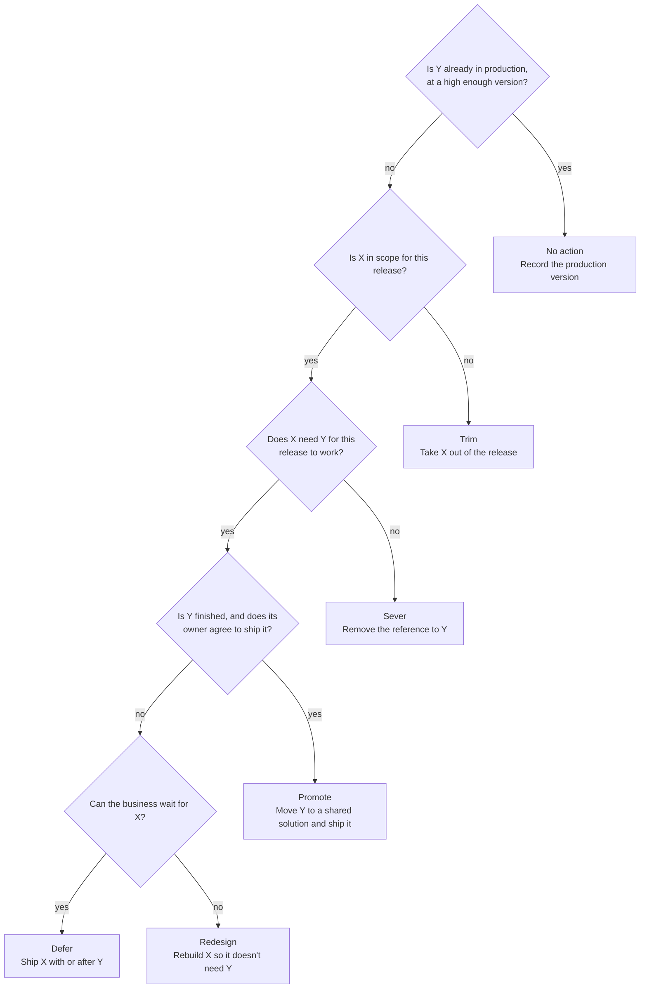

# Decision and fix playbook

Use this in Phase 3 and Phase 4 of the [README](../README.md). In every table, X is the component in the release and Y is the component it needs.

## Choose one action for each dependency

Every open row gets one action and a recorded approval. An AI agent can propose an action and give its evidence, but only the owners decide.

| Action | What the team does | Cost to weigh |
| --- | --- | --- |
| Trim | Takes X out of the solution, because it isn't part of this release | A table added with all objects must be removed and re-added |
| Sever | Removes the reference to Y from X | If the in-flight project still needs it, the fix applies to the release only |
| Promote | Moves Y to a shared solution in the release and ships it, unused if necessary | Y reaches production before its project, so its schema must be frozen |
| Defer | Takes X out and ships it with or after Y | This changes scope, so the business owner approves it |
| Redesign | Rebuilds X so it doesn't need Y | Highest effort, and X needs full retesting |

Some rules apply across all rows:

- **Start with the biggest wins.** Group rows by required component. The "Fix these first" table in `dependency-map.md` ranks them.
- **Check who else is affected.** `impact.csv` lists everything else that uses each component.
- **Mark the fix type.** Permanent fixes also go back to DEV. Release-only fixes stay in the release copy, because an in-flight project still needs that reference in DEV.
- **Look at the overall pattern.** If most rows point to one in-flight project, releasing that project first, or part of it, may cost less than fixing rows one by one.
- **Reuse one shared solution.** If the release already has a shared base solution, promote into it. Microsoft advises keeping the number of solutions small.

## Dependencies between the solutions in a release

A component held by another solution in the release needs no fix. It only sets the import order, which the audit reports as the release order.

| The audit reports | What it means | What to do |
| --- | --- | --- |
| Release order | Each solution needs only those above it | Import in that order, in the production copy and in production |
| Circular dependency | Two or more solutions in the release need each other, so no import order can work | Move what they share into one of them, or merge them. Fix the components named in the row. Nothing else closes it |
| Component in more than one target solution | The solution imported last decides what it looks like | Keep it in one solution |

## External audit results

External rows use the same five actions.

| Status | Usual meaning | Usual action |
| --- | --- | --- |
| Not in production | The item is finished, or still in development. Ask its owner | If finished, add it in Phase 5 and close the row with `Accepted: <how it ships>`. If not, treat it as In-flight |
| DEV only | DEV has it and production doesn't, and no scanned source uses it | Usually Trim. Keep it out of the production script |
| New in branch | The branch adds a function production doesn't have | Usually Trim, unless it belongs in this release |
| Removed by branch | The branch is behind production | Fix the branch, unless the removal is intended |
| Hardcoded flag | An address or key is written directly in source | Always fix it, even when production has the item |

## Fixes by dependency type

| The release depends on | Fix | Tool | Trap |
| --- | --- | --- | --- |
| In-flight column, lookup, sub-grid or web resource on a form | Remove the control and publish, or give the in-flight project its own form | `dv-metadata` | Hiding a field keeps the dependency |
| In-flight column in a view | Remove it from layout, filter and sort, then publish | `dv-metadata` | Customized Quick Find views bring their attributes regardless of segmentation |
| In-flight parts brought in by a table added with all objects | Remove the table and re-add only the parts that changed | Maker portal, `pac solution add-solution-component` | A table new to production must include all objects, so delete its in-flight columns in the release copy or Promote them |
| Lookup or relationship to an in-flight table | Delete it in the release copy, or Promote the table's schema | `dv-metadata` | A promoted table brings its own requirements, so walk the chain again |
| In-flight table, column or child flow in a cloud flow | Remove that action or branch | `power-automate`: `get_backup`, `preview_update`, `edit_flow`, `validate_flow` | The flow can import and still fail, so test a real run |
| In-flight table, connector or library in a canvas app | Remove the data source and the formulas that use it | `canvas-apps`: `list_data_sources`, `check_app`, `compile_canvas` | The text scan must include the `.msapp` |
| In-flight table or page in a model-driven app, site map or ribbon | Remove the entry and publish | Maker portal | Microsoft names these as a common source when several solutions edit one app |
| In-flight table in a security role | Remove the privilege in the release copy, or use one role per project | Maker portal | `dv-security` assigns roles but doesn't edit privileges |
| In-flight table in a plug-in step or assembly | Move the step to its owning solution, and split the assembly if the code needs Y | Agent on source, `pac plugin push` | An assembly ships whole, and table names in code aren't in the graph |
| In-flight names in a web resource | Remove or split that code path | Agent on the unpacked source | Relative links aren't tracked, so only the scan and tests catch them |
| Environment variable, connection reference or global choice | Promote it, and set values per environment | `pac solution create-settings` | A missing connection reference can fail the import |
| PCF control | Remove it from the form, or Promote the control | `pcf`: `pcf-inventory.js --where-used` | An empty result doesn't prove the control is unused |
| Managed solution newer in DEV than in production | Update production first, as its own tested change | Admin center | This adds a separate change and its own test cycle |
| In-flight table or column in a Power Pages form, list, table permission, Web API setting, Liquid or script | Remove the reference, or leave that site component out of the solution | `power-pages`: `setup-solution`, `audit-permissions` | New site components don't join the solution, and system tables must be added separately |
| Per-environment value in a Power Pages site setting | Link the setting to an environment variable | `power-pages`: `configure-env-variables` | Editing the site in the target creates an unmanaged layer |
| Hardcoded SharePoint site or list in a flow or canvas app | Use one environment variable for the site and one for the list | `power-automate`: `edit_flow`; `canvas-apps` | Column display and logical names must match between sites |
| Exported environment variable value pointing at DEV | Remove the value from the solution and set it in the settings file | `pac solution create-settings` | A current value exports with the solution unless removed |
| SharePoint list or column missing from production | If finished, add it to production first. If not, remove the reference | Script in Git (PnP PowerShell or CLI for Microsoft 365) | List IDs differ between sites, so match by name, never by ID |
| DEV only column on a shared SharePoint list | Leave it out of the production script, and confirm its owner | SharePoint owner | The audit can't tell which project added it |
| Hardcoded function URL in a flow, script or connector | Use an environment variable for the base address | `power-automate`: `edit_flow` | A hardcoded DEV address keeps calling DEV after the import |
| Function key in source | Move it to a Secret environment variable, then rotate the key | Azure owner | Secret variables need Azure Key Vault |
| Function the release calls that production lacks | Deploy it first, from the release branch | Pipeline, staging slot | The whole function app deploys with it |
| DEV only function in a shared app | Keep it out of the release branch, or move it to its own app | Git, Azure owner | `AzureWebJobs.<name>.Disabled` only stops triggers: the code still ships, and the setting restarts the app |
| In-flight tables or columns in function code | Remove that code path from the release branch, or Promote what it needs | Agent on source | Only the text scan catches this |

The tool names come from the plugins in Microsoft's [power-platform-skills](https://github.com/microsoft/power-platform-skills) marketplace. Its `dataverse` plugin, which provides the `dv-` skills, is developed in [Dataverse-skills](https://github.com/microsoft/Dataverse-skills). You can make the same changes by hand.

## Fixes in Azure DevOps branches

| The chosen branch | Fix | Tool | Trap |
| --- | --- | --- | --- |
| Uses in-flight names in plug-in or function code | Remove that code path from the release branch, or Promote what it needs | Agent on source | A hit in test code can mean the branch still holds that feature |
| Adds a plug-in type production doesn't have | Remove it from the release branch, unless it belongs in this release | Git, `pac plugin push` | An assembly ships whole |
| Lacks a plug-in type production registers | Restore the class, or unregister the type first | Git, Plugin Registration Tool | An assembly update can fail while a registered type is missing |
| Adds a function production doesn't have (New in branch) | Remove it from the release branch, or confirm it belongs | Git | The function app deploys as one unit |
| Lacks a function production has (Removed by branch) | Merge it from the production commit, or confirm the removal | Git | Deploying removes it, and its callers then fail at runtime |

## Keep dependencies out after the release

The same problem returns unless projects stop sharing unmanaged components.

- **One home per component.** A component sits in one unmanaged solution only.
- **One publisher and one shared solution.** The shared solution holds shared tables, choices, environment variables and connection references.
- **Add only what changed.** Use all objects only for a table that's new to the target environment.
- **Review required components.** Nobody adds them automatically.
- **No hardcoded addresses.** Every site, list and function address goes through an environment variable, and keys go through Azure Key Vault.
- **SharePoint changes in Git.** Lists and columns change only through a reviewed script.
- **One function app per release stream.** Otherwise, a shared app forces every project to release together.
- **Audit in the pipeline.** Both audit scripts exit with code 3 when rows are open, so they can fail a build.
- **Plan for separate DEV environments.** Microsoft recommends dedicated environments for large projects with several teams.

## Microsoft references

- [Removing dependencies overview](https://learn.microsoft.com/en-us/power-platform/alm/removing-dependencies)
- [Dependency tracking for solution components](https://learn.microsoft.com/en-us/power-platform/alm/dependency-tracking-solution-components)
- [Organize your solutions](https://learn.microsoft.com/en-us/power-platform/alm/organize-solutions)
- [Solution staging, with asynchronous import and export](https://learn.microsoft.com/en-us/power-platform/alm/solution-async)
- [StageSolution action](https://learn.microsoft.com/en-us/power-apps/developer/data-platform/webapi/reference/stagesolution)
- [Power Pages sites and solutions](https://learn.microsoft.com/en-us/power-pages/configure/power-pages-solutions)
