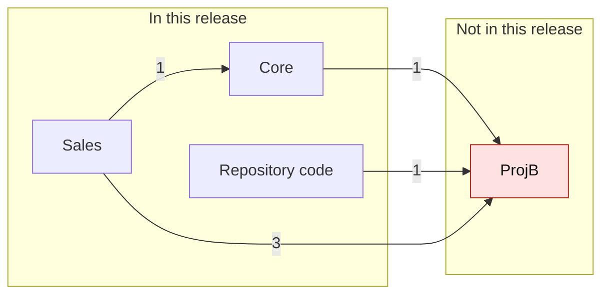
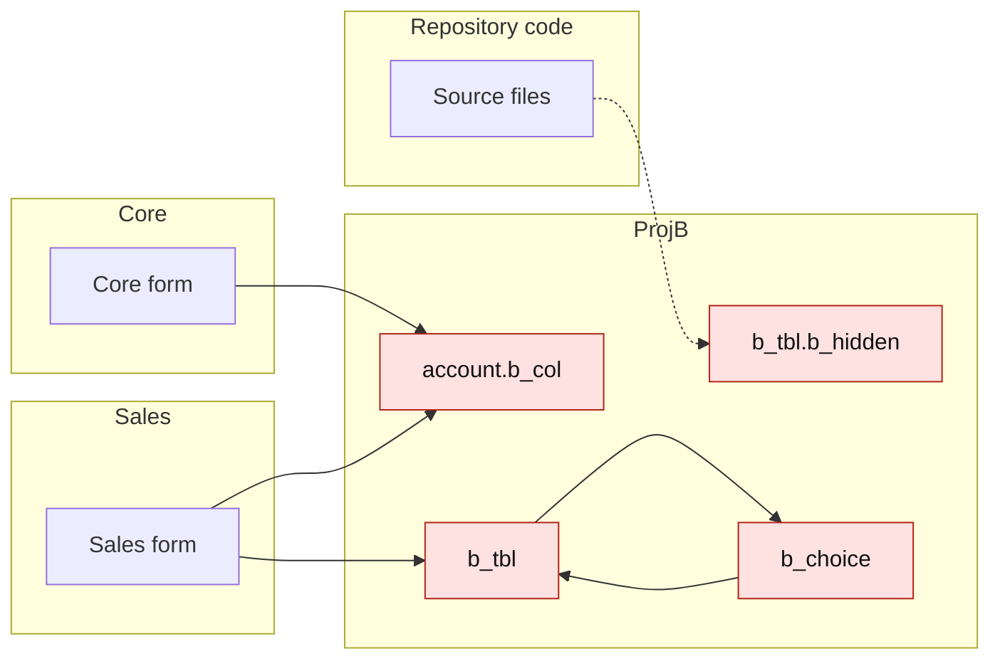

# Dependency map: Sales, Core

Generated from simulated environments by solution_dependency_audit 1.0.0.
DEV: https://contoso-dev.crm.dynamics.com. Production: https://contoso.crm.dynamics.com.

## Status

| Status | Rows |
| --- | --- |
| Unknown | 0 |
| In-flight | 6 |
| Version too old | 0 |
| False positive | 0 |
| Accepted | 0 |
| In production | 2 |
| In target | 1 |

## Gate 2

- Components found by only some sources, with no explanation: 1.

## Release order

Import in this order. Each solution needs only those above it.

1. Core
2. Sales (components needed from Core: 1)

Only Dataverse dependencies decide this order. References in code don't, because they don't stop an import.

## Coverage

- Text scan: files read 3, files not read 0, names searched 24, components that couldn't be named 0
- Dry run: Sales Failed, Core Failed

## Components in more than one target solution

This doesn't block an import, but the solution imported last decides what these look like. Keep each in one solution.

| Component | Type | Target solutions |
| --- | --- | --- |
| Core form | Form | Core, Sales |

## Fix these first

Components ranked by how many rows a fix would clear.

| Rows | Required component | Type | Status | Owning solutions | Needed by | Used by |
| --- | --- | --- | --- | --- | --- | --- |
| 2 | account.b_col | Column | In-flight | ProjB | Core, Sales |  |
| 2 | b_tbl | Table | In-flight | ProjB | Sales |  |
| 1 | b_choice | Global choice | In-flight | ProjB | Sales |  |
| 1 | b_tbl.b_hidden | Column | In-flight | ProjB (via table) |  |  |

## Solutions

Each arrow points to what a solution needs, and its number counts the components. Red solutions block the release. Grey solutions are in a circular dependency.

## Structure

Red is In-flight, amber is Version too old and grey is Unknown. Dashed arrows come from the text scan.

## Warnings

- Components in more than one target solution: 1. The solution imported last decides what they look like.
