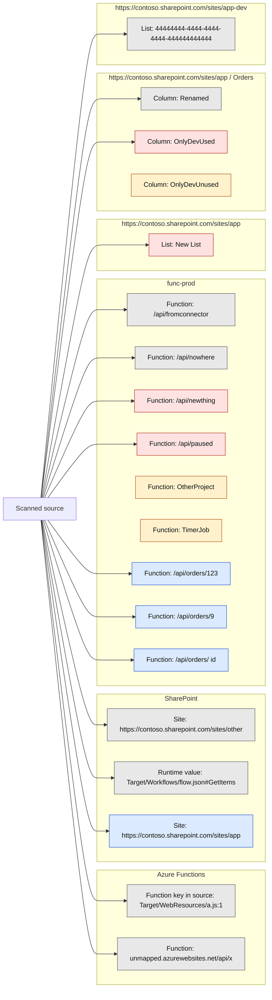

# External dependencies: SharePoint and Azure Functions

Generated from simulated environments by external_dependency_audit 1.0.0.
Scanned 7 files.

## Status

| Status | Rows |
| --- | --- |
| Unknown | 8 |
| Removed by branch | 0 |
| Not in production | 4 |
| New in branch | 0 |
| DEV only | 3 |
| False positive | 0 |
| Accepted | 0 |
| In production | 5 |
| Hardcoded addresses still open | 11 |

## Gate 2

- 8 Unknown rows have no explanation.

## Rows that need action

| Status | System | Kind | Name | Parent | Hardcoded | Detail |
| --- | --- | --- | --- | --- | --- | --- |
| Unknown | Azure Functions | Function key in source | Target/WebResources/a.js:1 |  | Yes | A URL here includes a function key. The value wasn't stored. Move it to a secure setting and rotate the key. |
| Unknown | Azure Functions | Function | unmapped.azurewebsites.net/api/x |  | Yes | This host isn't in the map file, so it can't be compared. Add its DEV and production pair. |
| Unknown | Azure Functions | Function | /api/fromconnector | func-prod | Yes | The DEV address is hardcoded. This route wasn't found in DEV or production. Check for a custom route or a proxy. |
| Unknown | Azure Functions | Function | /api/nowhere | func-prod | Yes | The DEV address is hardcoded. This route wasn't found in DEV or production. Check for a custom route or a proxy. |
| Unknown | SharePoint | Site | https://contoso.sharepoint.com/sites/other |  | Yes | This site isn't in the map file, so it can't be compared. Add its DEV and production pair. |
| Unknown | SharePoint | Runtime value | Target/Workflows/flow.json#GetItems |  |  | The site is set at runtime (@{triggerBody()?['site']}). Check by hand which site and list it uses in production. |
| Unknown | SharePoint | Column | Renamed | https://contoso.sharepoint.com/sites/app / Orders |  | The display name differs: DEV 'New label', production 'Old label'. Environment variables need them to match. |
| Unknown | SharePoint | List | 44444444-4444-4444-4444-444444444444 | https://contoso.sharepoint.com/sites/app-dev |  | The list wasn't found in the DEV site, so it can't be matched by name. |
| Not in production | Azure Functions | Function | /api/newthing | func-prod | Yes | The DEV address is hardcoded. Deployed in DEV, but not in production. |
| Not in production | Azure Functions | Function | /api/paused | func-prod | Yes | The production address is hardcoded. Function Paused is disabled in production. |
| Not in production | SharePoint | List | New List | https://contoso.sharepoint.com/sites/app |  | No production list has this display name. |
| Not in production | SharePoint | Column | OnlyDevUsed | https://contoso.sharepoint.com/sites/app / Orders |  | Used by the target, but missing from the production list. |
| DEV only | Azure Functions | Function | OtherProject | func-prod |  | In DEV only, and no scanned source calls it. A function app deploys as a whole, so this ships if DEV's code is deployed. |
| DEV only | Azure Functions | Function | TimerJob | func-prod |  | In DEV only, and no scanned source calls it. A function app deploys as a whole, so this ships if DEV's code is deployed. |
| DEV only | SharePoint | Column | OnlyDevUnused | https://contoso.sharepoint.com/sites/app / Orders |  | In the DEV list only, and no scanned source uses it. Confirm which project it belongs to. |
| In production | Azure Functions | Function | /api/orders/123 | func-prod | Yes | The DEV address is hardcoded. Function GetOrder |
| In production | Azure Functions | Function | /api/orders/9 | func-prod | Yes | The DEV address is hardcoded. Function GetOrder |
| In production | Azure Functions | Function | /api/orders/{id} | func-prod | Yes | The DEV address is hardcoded. Function GetOrder |
| In production | SharePoint | Site | https://contoso.sharepoint.com/sites/app |  | Yes | The DEV address is hardcoded. Environment variable t_site exports its current value with the solution. Production site: App |

## Structure

Red is missing or would be removed, amber is DEV only or new in the branch, grey is Unknown and blue is in production but hardcoded. Items with no arrow aren't used by any scanned source.
